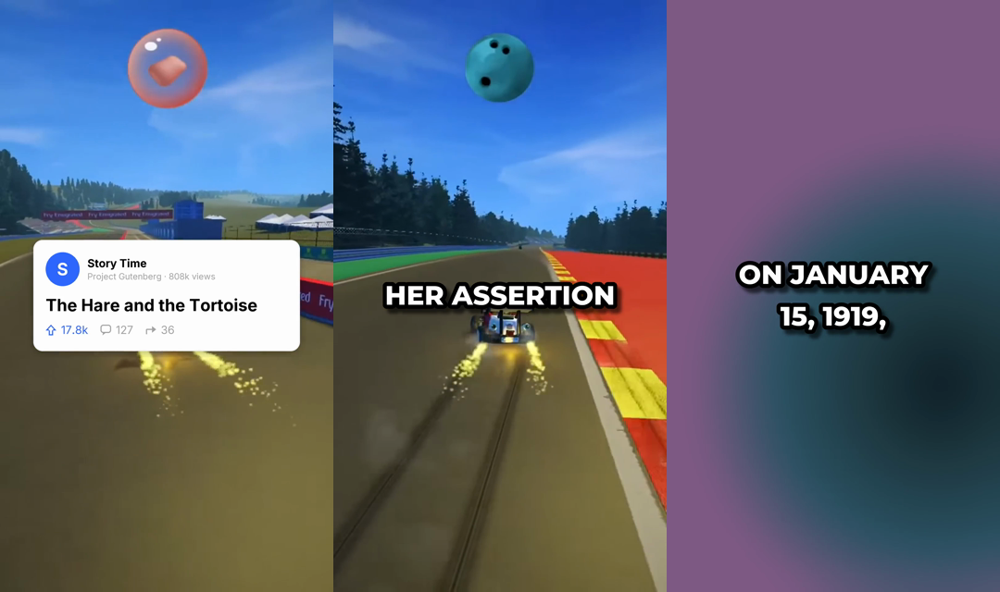

# videobot

Turn short stories into narrated, captioned vertical videos (1080×1920), from the command line or a small web page.

<p align="center"></p>
<p align="center"><sub>Footage: SuperTuxKart gameplay by kimden STK, <a href="https://commons.wikimedia.org/wiki/File:SuperTuxKart_2.x_GP_with_24%25_handicap_and_road_tracks_(open_source_Mario_Kart-like_Linux_game).webm">CC BY 3.0</a>. The numbers on the card are simulated.</sub></p>

- **Story database.** SQLite, pre-filled with 27 open-licence stories (Wikipedia introductions and Aesop's fables). Import more with one command, or add your own.
- **Free voices with exact word timings.** Microsoft Edge neural voices, no account needed. AWS Polly is optional.
- **Readable captions.** Grouped and timed by [autcaptions](https://github.com/julian-hilg/autcaptions): common-word ligatures, phrases, soft shadow.
- **Title card.** Shown while the title is read, optionally with simulated engagement numbers (`--stats simulated`).
- **No video library needed.** Generated animated backgrounds work out of the box. Add your own clips or free Pexels clips whenever you like.
- **Credits handled.** Every video gets a description with the story's source and licence.
- **Per-channel tracking.** A channel never reuses a story, and background clips rotate.

## Quick start

Needs Python 3.11+, [uv](https://docs.astral.sh/uv/) and [ffmpeg](https://ffmpeg.org) (with libass, the default in most builds).

```bash
git clone https://github.com/julian-hilg/videobot && cd videobot
uv sync --all-extras
uv run videobot make          # next unused story -> ~/Videobot/output/.../video.mp4
uv run videobot ui            # web interface at http://127.0.0.1:7860
```

A 40-second video renders in about 10 seconds on a laptop.

## Commands

```bash
videobot make                                   # one video from the next unused story
videobot make --count 5                         # five in a row
videobot make --story 4 --background life --voice en-GB-RyanNeural
videobot make --story 23 --stats simulated     # simulated views/upvotes on the title card

videobot stories list                           # id, used?, length, source, title
videobot stories show 4
videobot stories import-wikipedia "Tulip mania" "Halifax Explosion"
videobot stories import-fables                  # public-domain Aesop's fables
videobot stories add --title "My story" --file story.txt --source "my blog"

videobot library add ~/Movies/gameplay          # register your own clips
videobot library pexels "rain on window" --count 5   # free stock clips (PEXELS_API_KEY)
videobot library list

videobot card --story 4 -o card.png             # just the title card
videobot voices                                 # English voices (--lang de, fr, ...)
```

## How a video is made

```
story ─► voice (audio + word timings) ─► captions (.ass) ─┐
      └► title card (.png)                                ├─► ffmpeg (one pass) ─► video.mp4
         background (library clip or generated) ──────────┘
```

Each video gets its own folder, so any step can be inspected:

```
~/Videobot/output/2026-11-09_default_emu-war/
  video.mp4  description.txt  transcript.json  captions.ass  card.png  voice.mp3
```

`transcript.json` always uses the same format (text plus word timings), whichever voice made it. See [autcaptions](https://github.com/julian-hilg/autcaptions#one-transcript-format).

## Backgrounds

| `--background` | |
|---|---|
| `auto` (default) | a library clip this channel hasn't used yet, long enough for the video, else `gradient` |
| `gradient` | slowly moving colour gradient, generated by ffmpeg |
| `life` | calm, dark cellular animation, generated by ffmpeg |
| `path/to/clip.mp4` | that clip |

Clips of any shape are scaled and cropped to 9:16, starting at a random point.

## Voices

The default is Microsoft Edge's free online neural voices (`en-US-ChristopherNeural` at +15 % speed). `videobot voices` lists them all.

AWS Polly works too if you have it: `uv sync --extra polly`, configure AWS credentials, and use `--voice polly:Matthew`.

## Channels

`~/Videobot/channels.toml` is created on first run. Add a `[channels.<id>]` block per channel:

```toml
[channels.science]
name = "Science Bites"          # on the title card
handle = "@sciencebites"
avatar = "~/Pictures/logo.png"  # optional round profile picture
voice = "en-GB-RyanNeural"
rate = "+10%"
background = "auto"
music = "~/Music/calm.mp3"      # optional, mixed in quietly
music_volume = 0.04
hashtags = "#science #history"
stats = "none"                  # "simulated": made-up views/upvotes/comments/shares on the card
caption_font = ""               # optional: your own caption font file
caption_font_name = ""          # its font name, e.g. "The Bold Font"
```

Then `videobot make --channel science`.

## Content and licences

The bundled stories are either public domain (Aesop's fables, Project Gutenberg) or **CC BY-SA 4.0** (Wikipedia). Every video's `description.txt` contains the credit line, so paste it when you publish. CC BY-SA requires attribution, and a video made from such text should also be shared under CC BY-SA. Pexels clips are under the [Pexels License](https://www.pexels.com/license/). For clips you add yourself, put their credit in `videobot library add … --license "…"`. It's then added to every description that uses them.

Rebuild the bundled stories with `uv run python scripts/build_seed.py`.

## Settings

| Variable | |
|---|---|
| `VIDEOBOT_HOME` | data folder (default `~/Videobot`) |
| `PEXELS_API_KEY` | for `videobot library pexels` (free at pexels.com/api) |

## Background

videobot is a clean rewrite of the pipeline I built in 2024 to run TikTok story channels such as [@pinselscience](https://www.tiktok.com/@pinselscience). The videos made with it across multiple channels reached **more than 20 million views**. By 2026 standards maybe AI slop, but back then a true beast in farming views.

The original setup used AWS Polly voices and a hand-kept library of gameplay footage. This version runs with free voices and needs no footage. Polly, of course, is highly recommended. Will eventually add some new features in the future.

## Related

- [Diffusion Studio Core](https://github.com/diffusionstudio/core) by my friend Konstantin Paulus (with whom I also collaborated and who built a YC-startup off the idea): a fast, browser-based video compositing engine powered by WebCodecs, and the engine behind [Diffusion Studio](https://www.diffusion.studio). You should definitely check it out!

## Tests

```bash
uv run pytest
```

## License

The **code** is MIT licensed. The bundled Inter font is under the [SIL Open Font License](src/videobot/fonts/OFL.txt).

The bundled **stories** in [`seed_stories.json`](src/videobot/data/seed_stories.json) are not covered by MIT. Each entry carries its own licence: Wikipedia texts are [CC BY-SA 4.0](https://creativecommons.org/licenses/by-sa/4.0/) (by Wikipedia contributors, with links to the articles), and Aesop's fables are public domain.
